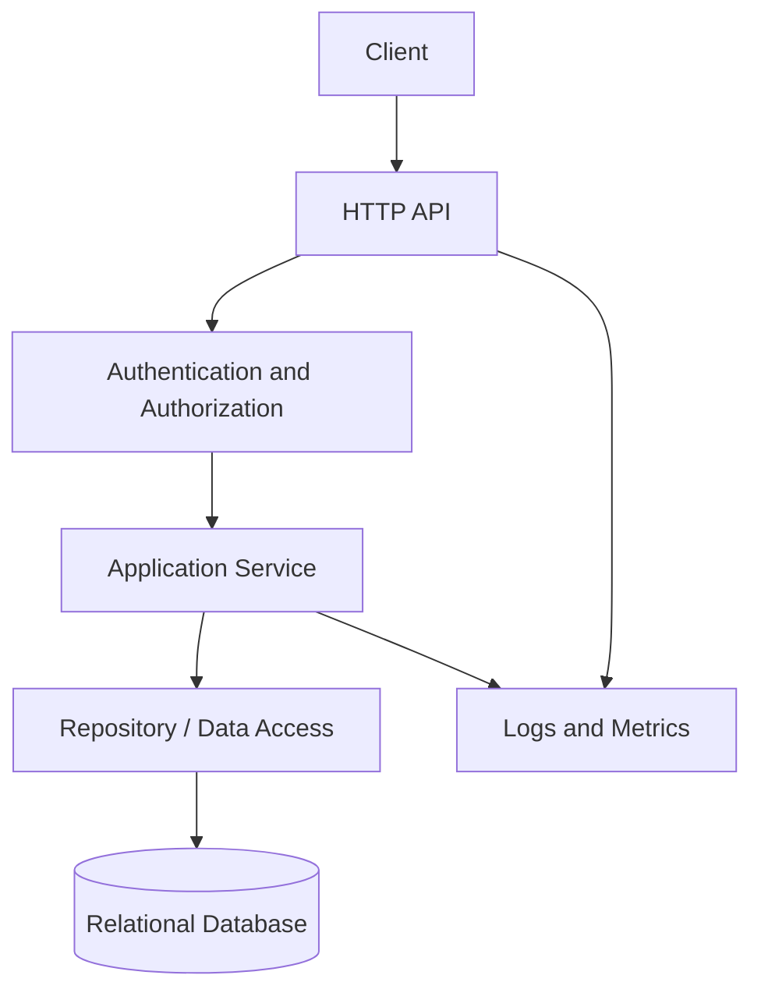

# Day 88 — Capstone Documentation and Architecture

## Sprint objective

Turn the current capstone into an understandable portfolio artifact. Document the actual implementation, its boundaries, setup, tests, operational signals, and known gaps. Do not claim a component is implemented unless the repository and configuration confirm it.

## Required documentation

- [ ] Problem statement and intended users.
- [ ] Functional requirements and nonfunctional goals.
- [ ] Setup instructions, environment variables, and safe example configuration.
- [ ] API endpoint table with methods, authentication, request/response examples, and status codes.
- [ ] Data model, relationships, constraints, and important indexes.
- [ ] Architecture diagram consistent with the code that exists.
- [ ] Testing commands and the latest observed results.
- [ ] Logging, metrics, health checks, and troubleshooting notes.
- [ ] Security boundaries, limitations, and deferred work.
- [ ] Demo script that can be completed reliably in a clean environment.

## Architecture diagram template

Update component names and remove components that are not implemented.

If caching, background jobs, or external services exist in the real project, show their failure paths and ownership boundaries. Do not add them to the diagram merely because they are common architecture components.

## README acceptance checklist

- [ ] A concise description explains the problem and key features.
- [ ] Prerequisites and setup commands are reproducible.
- [ ] Required environment variables are listed without real secrets.
- [ ] API examples match actual routes and schemas.
- [ ] Tests and quality checks have copy-pasteable commands.
- [ ] Architecture diagram reflects the current code.
- [ ] Screenshots or demo steps are included only when available.
- [ ] Known limitations are honest and actionable.
- [ ] No credentials, personal data, or production identifiers are committed.

## Suggested demo sequence

1. Start the application using documented setup instructions.
2. Demonstrate the primary successful workflow.
3. Show validation and a client-safe error response.
4. Demonstrate authorization denial for a resource the caller does not own.
5. Run the documented tests.
6. Explain one design trade-off, one observed limitation, and the next improvement.

## Sprint log

- Documentation updated:
- Diagram verified against code:
- Commands executed and results:
- Known gaps:
- Follow-up action:

## Completion criteria

Documentation is complete when a new reviewer can set up the project, understand the architecture, run the tests, follow one API workflow, and identify known limitations without relying on verbal explanation.
