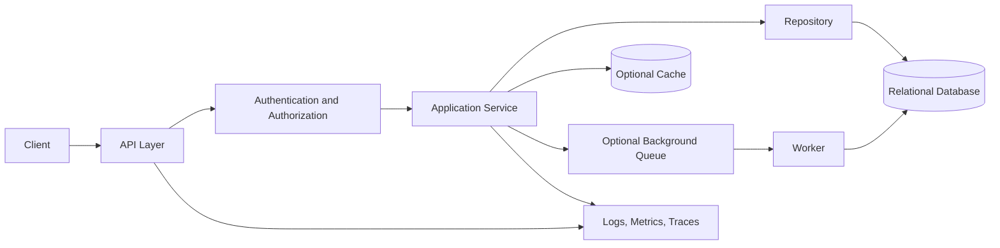

# Day 88 — System Design Weak-Area Repair

## Objective

Repair the specific gaps exposed by the Day 87 full system-design simulation. Select the two weakest dimensions and explain each trade-off without notes.

## Review checklist

- [ ] Requirements: distinguish functional requirements from measurable nonfunctional goals.
- [ ] Capacity: state assumptions, units, average/peak traffic, storage growth, and read/write ratio.
- [ ] API and data: align endpoint contracts, ownership rules, indexes, constraints, and pagination.
- [ ] Architecture: justify service boundaries and the role of cache, workers, and database.
- [ ] Reliability: define timeouts, bounded retries, backpressure, idempotency, and recovery.
- [ ] Security: cover authentication, authorization at the resource boundary, secrets, and audit signals.
- [ ] Observability: connect user-visible symptoms to actionable metrics, logs, and alerts.
- [ ] Trade-offs: state what is intentionally not built and what evidence would justify it.

## Task Manager API reference flow

Treat this as a discussion aid, not a claim that every component is already deployed. Add cache or queue infrastructure only when requirements and measurements justify it.

## Failure-mode drill

| Failure | Immediate behavior | Evidence to inspect |
|---|---|---|
| Database saturation | Apply timeouts and protect critical operations | Pool wait, query latency, error rate |
| Cache outage | Use a bounded fallback only if database capacity allows | Cache errors and database load |
| Worker backlog | Apply backpressure and prioritize critical work | Queue depth and oldest-message age |
| Duplicate write | Use an idempotency contract where required | Duplicate-key conflicts |
| Cross-user access | Deny at the service/data boundary | Authorization-denial audit event |

## Mock repair

1. Re-state the requirements and constraints.
2. Draw the smallest viable architecture.
3. Estimate traffic and storage with explicit assumptions.
4. Identify two bottlenecks and their measurable signals.
5. Explain one alternative and why you did not choose it.
6. End with risks, mitigations, and unresolved assumptions.

## Scorecard

| Dimension | Day 87 gap | Repair evidence | Re-score (0–2) |
|---|---|---|---:|
| Requirements and estimates | | | |
| API and data model | | | |
| Reliability and security | | | |
| Trade-offs and communication | | | |
