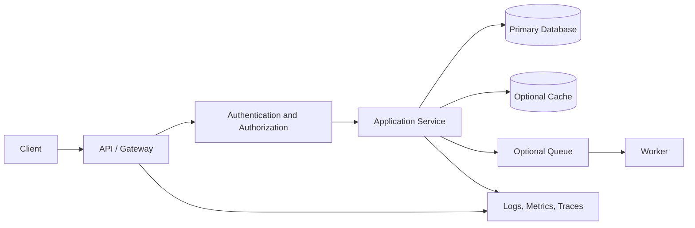

# Day 89 — Final System Design Mock Interview

## Objective

Run one end-to-end mock interview. Choose a familiar service, such as a URL shortener, Task Manager API, notification service, or news feed. Focus on structured reasoning and explicit trade-offs rather than adding unnecessary components.

## 45-minute interview structure

| Time | Stage | Expected output |
|---:|---|---|
| 0–5 min | Requirements | Functional scope, users, constraints, success metrics |
| 5–10 min | Estimation | Traffic assumptions, peak load, storage and growth |
| 10–18 min | API and data | Endpoints, entities, indexes, consistency requirements |
| 18–28 min | Architecture | Components, request flow, synchronous vs asynchronous work |
| 28–36 min | Reliability and scale | Bottlenecks, timeouts, retries, backpressure, caching |
| 36–42 min | Security and operations | Auth boundaries, secrets, metrics, logs, alerts, recovery |
| 42–45 min | Trade-offs | Alternatives rejected, risks, next design iteration |

## Architecture sketch

Remove components that do not fit the selected problem or are not justified by the requirements.

## Interview checklist

- [ ] Clarified scope and nonfunctional requirements before designing.
- [ ] Stated assumptions with units and rough calculations.
- [ ] Defined API contracts and data ownership.
- [ ] Explained indexes, consistency, and transaction boundaries.
- [ ] Identified at least two bottlenecks and measurable signals.
- [ ] Covered timeouts, bounded retries, idempotency, and failure recovery.
- [ ] Addressed authentication, authorization, and secret handling.
- [ ] Explained trade-offs and a simpler viable alternative.

## Self-review

| Dimension | Score (1–5) | Evidence / gap |
|---|---:|---|
| Requirements and estimation | | |
| API and data model | | |
| Architecture and trade-offs | | |
| Reliability and scalability | | |
| Security and observability | | |
| Communication and structure | | |

## Completion criteria

Summarize the two strongest areas, the two weakest areas, and one concrete practice action for each weak area. Avoid claiming production readiness without implementation and test evidence.
